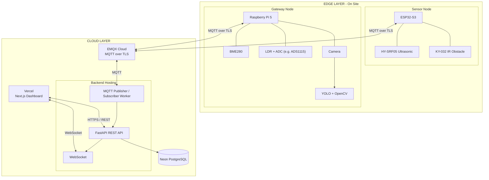

# AGENTS.md

## Project Overview

Smart Parking is an IoT application built as a monorepo. It consists of edge devices, cloud messaging, a cloud backend, a cloud database, and a web frontend.

### Confirmed Architecture Decisions

- **Sensor Node:** ESP32-S3 using C++.
- **Gateway Node:** Raspberry Pi 5 using Python.
- **Gateway connectivity:** Raspberry Pi 5 connects directly to the cloud MQTT broker. Do not add a local MQTT broker or MQTT bridge unless the project requirements are explicitly changed.
- **MQTT Broker:** EMQX Cloud.
- **Backend:** Python with FastAPI.
- **Database:** Neon Serverless PostgreSQL.
- **Frontend:** Next.js App Router with TypeScript.
- **Styling:** Tailwind CSS.
- **Real-time frontend updates:** WebSocket provided by the backend.
- **Image processing:** YOLO and OpenCV on Raspberry Pi 5.
- **Proposed hosting:** Render for backend services and Vercel for the frontend. Keep deployment configuration portable where practical.

### System Responsibilities

- **ESP32-S3:** Reads locally connected sensors (HY-SRF05 ultrasonic sensor and KY-032 IR obstacle sensor), publishes sensor readings to EMQX Cloud, and subscribes to commands for any actuators assigned to the ESP32.
- **Raspberry Pi 5:** Reads BME280 and LDR data, captures camera images, performs YOLO/OpenCV processing, publishes gateway and detection data to EMQX Cloud, and subscribes to relevant sensor messages and commands when needed.
- **EMQX Cloud:** Routes MQTT messages between authorized devices and backend clients. It is the only MQTT broker in the confirmed architecture.
- **FastAPI backend:** Provides REST APIs, runs MQTT publisher/subscriber functionality, applies parking business logic, persists data, and broadcasts real-time updates through WebSocket.
- **Neon PostgreSQL:** Stores device metadata, sensor readings, parking slot status, vehicle detections, and other application records.
- **Next.js frontend:** Displays parking availability, device status, sensor information, and analytics by consuming backend REST APIs and WebSocket updates.

## Architecture and Data Flow



### MQTT Communication Rules

- ESP32-S3 and Raspberry Pi 5 connect directly to EMQX Cloud using MQTT over TLS.
- The FastAPI backend connects to EMQX Cloud as an MQTT client.
- The backend MQTT worker subscribes to device telemetry and publishes authorized commands.
- Raspberry Pi 5 may subscribe to ESP32 telemetry for gateway-level aggregation or local processing. The backend also subscribes independently when it needs to persist or process the same messages.
- MQTT is not routed through the frontend. Browser clients use the backend REST API and WebSocket.
- Do not send full camera images or Base64-encoded image payloads through MQTT. Publish detection metadata and, when needed, an object-storage reference instead. Object storage provider remains a deployment decision.
- Use stable device identifiers and a documented topic convention. Restrict publish/subscribe permissions with broker credentials and topic ACLs.

### Active MQTT Topic Convention

The following topics are the active project convention (see [`docs/mqtt/topics.md`](docs/mqtt/topics.md) for full payload schemas, QoS, and retain settings).

| Topic | Publisher | Subscribers | QoS / Retain | Purpose |
|---|---|---|---|---|
| `parking/status` | Raspberry Pi 5 | Backend | QoS 0 / Retained | Master snapshot: bay states (`P1`–`P6`), camera, counts, barrier gate, GPIO pins, IR sensors |
| `parking/vision/detection` | Raspberry Pi 5 | Backend | QoS 0 / No | YOLO inference FPS, detection metadata, and bay occupancy/pending states |
| `parking/sensor/entrance` | Raspberry Pi 5 | Backend | QoS 0 / No | Entrance/exit IR sensor readings and ultrasonic obstacle distance |
| `parking/sensor/environment` | YD-ESP32-23 | Raspberry Pi 5, backend | QoS 0 / No | [LDR and BME280 readings](docs/architecture/esp32-telemetry.md) |
| `parking/lighting/status` | YD-ESP32-23 | Raspberry Pi 5, backend | QoS 0 / Retained | Current state (`leds_on`) of the three parking lights |
| `parking/control/lighting` | Backend, Raspberry Pi 5 | YD-ESP32-23 | QoS 1 / No | Lighting commands (`ON`, `OFF`, or `AUTO`) |
| `parking/control/barrier` | Backend | Raspberry Pi 5 | QoS 1 / No | Barrier gate commands (`OPEN`, `CLOSE`, or `AUTO`) |

Define payload schemas, timestamps, units, device IDs, QoS, retain behavior, and command acknowledgement behavior in `docs/architecture/` before relying on them in production.

## Project Structure

```text
project-root/
├── frontend/                   # Next.js App Router application
│   ├── src/
│   │   ├── app/                # Routes and layouts
│   │   ├── components/
│   │   │   ├── ui/             # Reusable UI primitives
│   │   │   └── shared/         # Shared application components
│   │   ├── features/           # Feature-specific UI and logic
│   │   ├── hooks/              # Custom React hooks
│   │   ├── lib/
│   │   │   ├── api/            # Backend API clients
│   │   │   ├── utils/
│   │   │   └── validations/
│   │   ├── types/
│   │   └── styles/
│   └── package.json
│
├── backend/                    # FastAPI cloud backend
│   ├── src/
│   │   ├── api/                # HTTP routes and dependencies
│   │   ├── features/           # Parking, sensors, devices, analytics
│   │   ├── mqtt/
│   │   │   ├── subscriber/     # MQTT subscription handlers
│   │   │   └── publisher/      # MQTT publishing services
│   │   ├── database/           # Neon connection, models, repositories
│   │   ├── services/           # Business logic
│   │   ├── websocket/          # Real-time connection management
│   │   └── main.py             # FastAPI application entry point
│   ├── tests/
│   └── requirements.txt
│
├── firmware/
│   └── esp32/
│       ├── src/
│       │   ├── sensors/
│       │   ├── mqtt/
│       │   └── main.cpp
│       └── platformio.ini
│
├── gateway/                    # Raspberry Pi 5 application
│   ├── sensors/                # BME280 and LDR acquisition
│   ├── camera/                 # Camera capture
│   ├── processing/             # YOLO/OpenCV and parking logic
│   ├── mqtt/                   # Direct EMQX Cloud MQTT client
│   ├── config/
│   ├── tests/
│   └── main.py
│
├── docs/
│   ├── architecture/           # Architecture decisions and diagrams
│   ├── api/                    # REST and WebSocket contracts
│   └── mqtt/                   # Topics and payload schemas
│
├── infrastructure/
│   ├── docker/                 # Dockerfiles and service images
│   └── deployment/             # Render, Vercel, and cloud configuration
│
├── .env.example
├── docker-compose.yml
├── AGENTS.md
└── README.md
```

## General Development Guidelines

### 1. Code Quality

- Write clean, readable, and maintainable code.
- Follow the conventions and coding standards of the selected language and framework.
- Prefer simple solutions over unnecessary abstractions.
- Avoid duplicated logic; extract reusable code when appropriate.
- Use meaningful names for variables, functions, components, and files.
- Keep functions and components focused on a single responsibility.
- Do not introduce dependencies unless they provide clear value.

### 2. Architecture

- Keep frontend, backend, firmware, and gateway responsibilities separate.
- Organize application code by features or business domains.
- Avoid unnecessary coupling between modules.
- Keep business logic separate from presentation and infrastructure concerns.
- Keep database access isolated from business logic.
- Define clear interfaces and documented contracts between devices, MQTT, backend, database, and frontend.
- Do not prematurely introduce shared packages or complex abstractions.
- Keep cloud services independent: EMQX Cloud handles MQTT messaging, FastAPI handles application logic, Neon stores relational data, and Next.js serves the user interface.

### 3. Type Safety

- Use TypeScript for frontend development.
- Use Python type hints for backend and gateway code.
- Avoid `any` unless absolutely necessary.
- Define explicit API request and response schemas.
- Validate external input at application boundaries.
- Handle nullable and optional values explicitly.

### 4. Error Handling

- Handle errors explicitly.
- Never silently ignore unexpected errors.
- Provide meaningful error messages.
- Avoid exposing internal implementation details or sensitive information to clients.
- Implement reconnect and retry behavior for MQTT and database connections with bounded backoff.
- Ensure device and backend behavior remains predictable during temporary Internet or cloud outages.

### 5. Security

- Never commit secrets, API keys, credentials, or private environment variables.
- Validate and sanitize user input.
- Enforce authorization on the backend.
- Never trust frontend validation as a security boundary.
- Use environment variables for configuration.
- Use MQTT over TLS for device and backend connections to EMQX Cloud.
- Use separate credentials and least-privilege topic ACLs for ESP32, Raspberry Pi, and backend clients.
- Do not expose Neon credentials or MQTT broker credentials to the frontend.
- Follow secure authentication and session management practices.

## Frontend Guidelines

### Technology

- Next.js with App Router.
- TypeScript.
- Tailwind CSS.
- ESLint.

### Directory Responsibilities

```text
frontend/src/
├── app/                   # Routes and layouts
├── components/
│   ├── ui/                # Reusable UI primitives
│   └── shared/            # Shared application components
├── features/              # Feature-specific implementation
├── hooks/                 # Custom React hooks
├── lib/
│   ├── api/               # API clients
│   ├── utils/             # Utility functions
│   └── validations/        # Input validation schemas
├── types/                 # TypeScript types
└── styles/                # Global styles
```

### Frontend Rules

- Use Server Components by default.
- Use Client Components only when interactivity or browser APIs are required.
- Keep page components focused on composition and routing.
- Put feature-specific components and logic inside their respective `features/` directories.
- Use reusable components for genuinely shared UI.
- Keep API communication inside `lib/api/` or feature-specific API modules.
- Receive real-time updates through the backend WebSocket. Do not connect the browser directly to the MQTT broker unless a separately reviewed requirement explicitly calls for it.
- Avoid unnecessary client-side state management.
- Use semantic HTML and accessible UI patterns.
- Follow responsive design principles.
- Avoid duplicating styles and UI logic.

## Backend Guidelines

### Technology

- Python.
- FastAPI.
- Pydantic for request, response, and configuration validation.
- SQLAlchemy for database access.
- Neon PostgreSQL as the managed database.
- An MQTT client library such as Paho-MQTT for EMQX Cloud connectivity.

### Backend Responsibilities

- Expose REST API endpoints for frontend application features.
- Maintain MQTT publisher and subscriber functionality as a long-running worker.
- Validate and process incoming MQTT payloads.
- Apply parking and device business logic.
- Persist application data to Neon PostgreSQL.
- Broadcast relevant updates to connected frontend clients using WebSocket.
- Publish authorized actuator commands to the appropriate MQTT topics.

### Backend Rules

- Separate HTTP route handling, business logic, MQTT integration, and data access.
- Do not make MQTT subscription lifecycle depend on an individual HTTP request.
- Run the MQTT worker as a separately managed process/service where supported by the deployment platform.
- Make message processing safe against duplicate delivery; MQTT QoS 1 can deliver duplicates.
- Use database transactions where appropriate.
- Use connection pooling and Neon-supported connection settings.
- Do not assume the database is always immediately available; handle connection failures and retries.
- Keep API response schemas separate from database models.
- Document REST endpoints, WebSocket events, and MQTT payload contracts.

## Gateway Guidelines

### Technology

- Raspberry Pi 5.
- Python.
- Paho-MQTT or another maintained MQTT client.
- OpenCV and YOLO for image processing.
- Appropriate sensor libraries for BME280 and the selected ADC.

### Gateway Rules

- Connect directly to EMQX Cloud over MQTT with TLS.
- Do not install or operate a local MQTT broker in the confirmed architecture.
- Read BME280 and LDR data locally. Raspberry Pi 5 has no built-in analog input; use an external ADC such as ADS1115 for an analog LDR circuit.
- Capture and process images locally using the camera, OpenCV, and YOLO.
- Publish structured detection metadata through MQTT; do not publish full images or large Base64 image payloads through MQTT.
- Subscribe only to topics required for gateway processing and commands.
- Implement reconnect, bounded retry, and local buffering for temporary Internet outages.
- Keep device credentials outside source control.

## ESP32 Firmware Guidelines

- Use C++ and the project's selected ESP32 build system.
- Keep sensor acquisition, MQTT communication, and actuator control in separate modules.
- Connect directly to EMQX Cloud using MQTT over TLS where supported by the device configuration.
- Publish documented, structured payloads with device identifiers, timestamps, and explicit measurement units.
- Subscribe only to command topics required by the device.
- Implement reconnect behavior and bounded local buffering where feasible.
- Avoid blocking sensor acquisition for long periods while waiting for network operations.

## MQTT Guidelines

- EMQX Cloud is the cloud MQTT broker.
- ESP32-S3, Raspberry Pi 5, and the backend connect as MQTT clients directly to EMQX Cloud.
- Raspberry Pi 5 is a gateway application, not an MQTT broker.
- Use TLS, per-client credentials, and topic-level access control.
- Document topic names, publishers, subscribers, payload schemas, QoS, retain settings, and command acknowledgement behavior.
- Use QoS according to message importance and delivery requirements; do not assume QoS 1 means exactly-once processing.
- Use retained messages only for state where the latest retained value is meaningful.
- Use Last Will and Testament or an explicit heartbeat strategy for device availability where appropriate.
- Keep payloads compact and version schemas when breaking changes are introduced.
- Do not use MQTT as the transport for full camera images.

## Database Guidelines

- Use Neon PostgreSQL.
- Keep database credentials on the backend only.
- Use migrations for schema changes.
- Model devices, sensor readings, parking slots, parking status, and vehicle detections according to documented domain requirements.
- Add indexes for common query patterns, especially device IDs, slot IDs, and timestamps.
- Use connection pooling appropriate to the deployment environment.
- Plan for Neon Free Tier compute and storage limits; do not assume unlimited always-on capacity.
- Avoid storing raw camera images in PostgreSQL. Store object-storage references and metadata if image retention is required.

## API Guidelines

- Use RESTful conventions unless the project establishes another API style.
- Use appropriate HTTP methods and status codes.
- Keep request and response structures consistent.
- Version APIs when necessary.
- Document endpoints, parameters, authentication, and response schemas.
- Do not expose database models directly as API contracts.
- Use WebSocket for server-to-client real-time dashboard updates where appropriate.
- Authenticate and authorize protected API and WebSocket connections.

## Environment Configuration

- Keep frontend, backend, gateway, and firmware configuration separate.
- Maintain `.env.example` files documenting required variables without real secrets.
- Never commit actual `.env` files.
- Do not hardcode environment-specific URLs or credentials.
- Frontend variables exposed to the browser must not contain secrets.
- Backend environment configuration should include the EMQX endpoint and credentials, Neon database URL, and application security settings.
- Gateway and ESP32 configuration should include only their own device credentials and required broker settings.

## Testing Guidelines

- Write tests for important business logic.
- Test MQTT payload validation and message handling.
- Test duplicate message handling and reconnect behavior.
- Test database access and migration behavior.
- Test REST endpoints and WebSocket event flows.
- Test edge cases and failure scenarios, including Internet and broker outages.
- Ensure existing tests pass before completing changes.
- Do not remove or weaken tests simply to make a build pass.
- Add regression tests when fixing bugs.

## Git Guidelines

Use Conventional Commits:

- `feat`: New features.
- `fix`: Bug fixes.
- `refactor`: Code restructuring without behavior changes.
- `docs`: Documentation changes.
- `test`: Test-related changes.
- `chore`: Maintenance tasks.
- `style`: Formatting and styling changes.

Examples:

```text
feat(auth): add login functionality
fix(api): handle invalid request payloads
refactor(frontend): simplify dashboard components
docs: update system architecture
```

## Deployment Guidelines

- Frontend is intended to be deployed to Vercel.
- FastAPI backend and its MQTT worker are intended to be deployed to a platform that supports long-running processes, such as Render.
- Neon PostgreSQL is the managed database.
- EMQX Cloud is the managed MQTT broker.
- Verify that the chosen backend hosting plan supports persistent outbound MQTT connections and WebSocket connections before deployment.
- Do not deploy the MQTT subscriber as a short-lived serverless function.
- Keep Dockerfiles and deployment configuration under `infrastructure/` where practical.
- Keep local development setup documented in `docker-compose.yml`; cloud-managed EMQX and Neon remain external services unless a local development profile is explicitly added.

## Instructions for Coding Agents

Before making changes:

1. Inspect the existing project structure.
2. Read relevant documentation and existing implementation.
3. Understand the affected modules and their dependencies.
4. Follow existing conventions unless there is a clear reason to improve them.
5. Treat the Confirmed Architecture Decisions in this file as project decisions. Do not silently replace selected technologies.

While implementing:

1. Make focused, incremental changes.
2. Avoid modifying unrelated files.
3. Do not overwrite existing implementations without understanding them.
4. Do not introduce unnecessary dependencies.
5. Keep documentation updated when architecture or behavior changes.
6. If a change would alter a confirmed architecture decision, explain the trade-off and request approval before proceeding.

After implementing:

1. Run relevant linting and formatting checks.
2. Run relevant tests.
3. Run type checking and production builds when applicable.
4. Fix issues introduced by the changes.
5. Summarize what changed and mention any remaining limitations.
