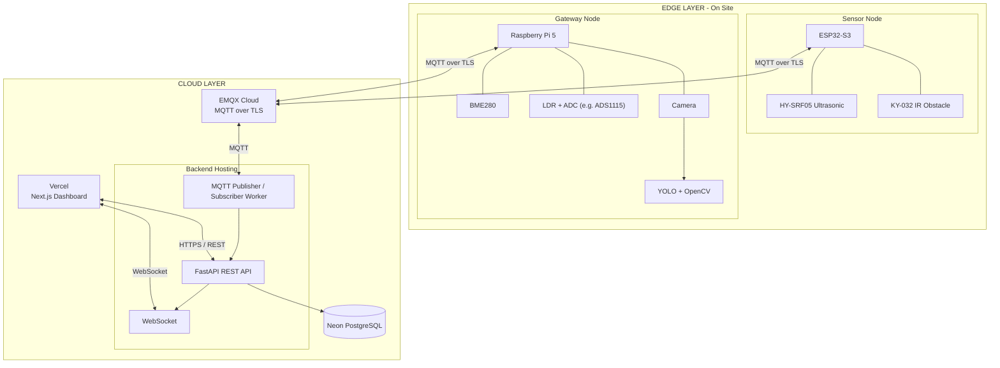

# Smart Parking

IoT smart parking system: edge sensors detect vehicles, a gateway runs camera-based vehicle detection, and a cloud backend serves a real-time parking dashboard.

A monorepo with five parts:

- **ESP32-S3 firmware** — reads an ultrasonic distance sensor (HY-SRF05) and an IR obstacle sensor (KY-032), publishes readings over MQTT, and receives actuator commands.
- **Raspberry Pi 5 gateway** — reads BME280 environment data and an LDR light sensor, captures camera images, and runs YOLO/OpenCV vehicle detection; publishes telemetry and detection metadata over MQTT.
- **Cloud backend** — Python/FastAPI service that consumes MQTT telemetry, applies parking business logic, persists data, and serves REST + WebSocket APIs.
- **Frontend dashboard** — Next.js (App Router, TypeScript, Tailwind) showing parking availability, device status, sensor data, and analytics.
- **ML model training** — YOLOv11 toy-car detection model trained from a [Roboflow dataset](https://universe.roboflow.com/shyam-47kjr/my-first-project-rmlqk), deployed to the gateway for vehicle detection.

## Architecture



MQTT is the only device-to-cloud transport. The frontend never talks to the broker directly — it consumes backend REST and WebSocket APIs. See [AGENTS.md](AGENTS.md) for the full architecture rules and [MQTT topic convention](AGENTS.md#initial-mqtt-topic-convention).

## Tech Stack

| Layer | Technology |
|---|---|
| Sensor node | ESP32-S3, C++ (PlatformIO) |
| Gateway node | Raspberry Pi 5, Python, OpenCV, YOLO |
| MQTT broker | EMQX Cloud (TLS) |
| Backend | Python, FastAPI, SQLAlchemy, Paho-MQTT |
| Database | Neon serverless PostgreSQL |
| Frontend | Next.js App Router, TypeScript, Tailwind CSS |
| ML training | Ultralytics YOLOv11, PyTorch (CUDA) |
| Hosting | Render (backend + MQTT worker), Vercel (frontend) |

## Repository Layout

```text
├── backend/           # FastAPI cloud backend (implemented)
├── frontend/          # Next.js dashboard (implemented)
├── models/            # YOLOv11 toy-car detection training (implemented)
├── infrastructure/    # Dockerfiles and deployment config (backend done)
├── firmware/          # ESP32-S3 firmware (planned)
├── gateway/           # Raspberry Pi 5 application (planned)
└── docs/              # Architecture, API, and MQTT contracts (planned)
```

## Current Status

Implemented:

- **Backend** — user registration/login (JWT auth), roles, health check with DB connectivity probe, Alembic migrations. MQTT worker, parking/sensor/analytics features are scaffolded but empty.
- **Frontend** — login/register pages wired to the backend, dashboard layout, parking and settings pages, account menu.
- **Models** — complete training pipeline: dataset download from Roboflow, CUDA training on YOLOv11, evaluation, prediction. Latest model reaches ~0.97 mAP50-95 on the held-out test split.
- **Infrastructure** — backend Dockerfile and docker-compose service.

Planned: ESP32 firmware, gateway application, MQTT integration (device credentials, ACLs, payload schemas), parking business logic, real-time WebSocket updates, analytics.

## Getting Started

### Backend

```sh
cd backend
cp .env.example .env   # set DATABASE_URL to your Neon connection string
uv sync
uv run fastapi dev src/main.py
```

Dev server runs on port 8000; `/health` checks database connectivity.

### Frontend

```sh
cd frontend
npm install
cp .env.example .env   # point it at the backend URL
npm run dev
```

Dev server runs on port 3000.

### Model Training

See [models/README.md](models/README.md) for the full guide. Short version:

```sh
cd models
python -m venv .venv && .venv/Scripts/Activate   # Windows; `source .venv/bin/activate` on Linux
pip install torch torchvision --index-url https://download.pytorch.org/whl/cu132
pip install -r requirements.txt
export ROBOFLOW_API_KEY="<your-key>"
python download_dataset.py
python train.py --batch 8        # RTX 3050 4GB-class GPU
python predict.py --source path/to/photo.jpg
```

### Full Stack via Docker

```sh
cp backend/.env.example backend/.env   # configure DATABASE_URL first
docker compose up --build backend
```

## Documentation

- [AGENTS.md](AGENTS.md) — confirmed architecture decisions, coding guidelines, MQTT topic convention.
- [backend/README.md](backend/README.md) — backend development and deployment notes.
- [frontend/README.md](frontend/README.md) — frontend development notes.
- [models/README.md](models/README.md) — dataset, CUDA setup, training, evaluation, and prediction guide.
